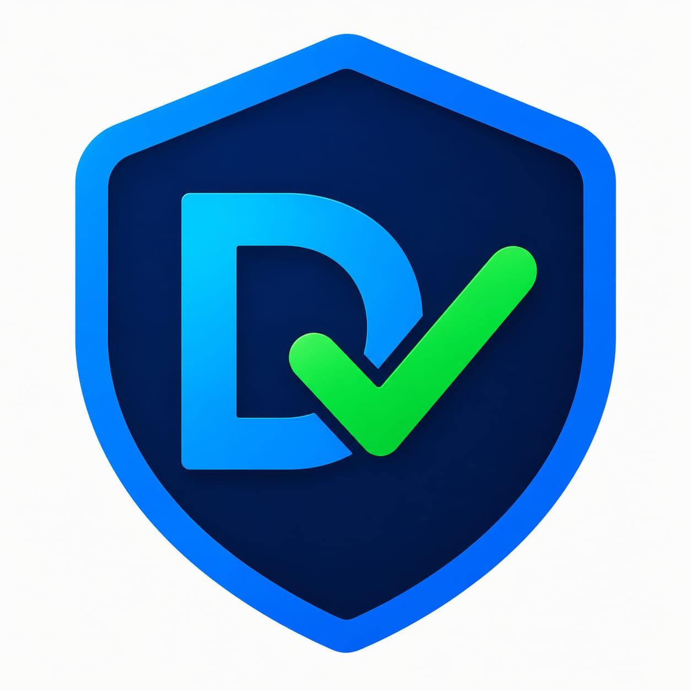

# DueVestor - due diligence on a company or person

**DueVestor** is an autonomous due-diligence platform: it screens a company or a person against public government and multilateral sources and returns a cited report.

<a href="https://duevestor.com/en/pricing?utm_source=github&utm_medium=readme"><b>Start with one free report &rarr;</b></a> 
No card required. One free report per account, per company e-mail domain, and per subject.

## What you get
- A report on one subject with cited evidence, built from public sources such as OFAC, UN, EU and UK sanctions lists, SEC EDGAR, Companies House and GLEIF.
- A REST API for reports, monitoring and source status (some screening endpoints are not available yet). API docs: https://duevestor.com/api/v1/docs
- A sample report: https://duevestor.com/en/samples

## Pricing (as of 2026-11-22; current prices: https://duevestor.com/en/pricing)
- One report at $199; 5-pack $799; 15-pack $1,799. No contracts, no minimums.
- API tiers: Developer $99/mo, Business $999/mo, Enterprise $4,999/mo.

## Please note
- Not every source can be checked for every subject; a report says which checks could not be run, and never calls an unchecked source 'clean'.
- DueVestor reports are information for your own decision, not legal, financial or investment advice.

## For agents
- llms.txt: https://duevestor.com/llms.txt
- API docs: https://duevestor.com/api/v1/docs

## Part of Enterprise.Systems
DueVestor is an [Enterprise.Systems](https://enterprise.systems) product.
Sister products: [ASI.EXPRESS](https://asi.express) · [8200.dev](https://8200.dev) · [Foretell](https://foretell.technology) · [checkup.report](https://checkup.report) · [calculator.realestate](https://calculator.realestate)

Docs and images: [CC BY 4.0](LICENSE).